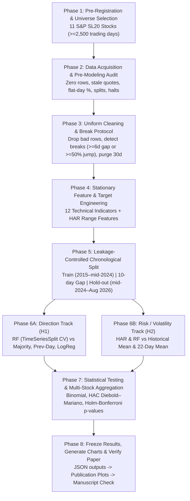

# Project Remake Workflow: From Rejected Case Study to Leakage-Controlled Multi-Stock CSE Evaluation

> **Reference Sources**
> - Target Publication Standard: [`AIMT_abstract_fernando.pdf`](AIMT_abstract_fernando.pdf) — *"Next-day direction and risk forecasting on the Colombo Stock Exchange: a leakage-controlled evaluation of eleven S&P SL20 stocks"*
> - Revision & Audit Log: [`Claude_Revising-rejected-conference-abstract-for-publication_20261119-2133.md`](Claude_Revising-rejected-conference-abstract-for-publication_20261119-2133.md)

---

## 1. Executive Summary: Why This Project Must Transform

The original `Case 02 project` (single-stock JKH Random Forest classifier across `notebooks/01_eda.ipynb`–`10model.ipynb`) was rejected at conference review because its apparent **54.77% accuracy** was an artifact of data leakage, unadjusted corporate actions, and missing baselines rather than genuine predictive skill.

Transforming the project into the standard represented by [`AIMT_abstract_fernando.pdf`](AIMT_abstract_fernando.pdf) requires a **complete methodological and architectural remake** across data, features, splitting, modeling, statistical testing, and reporting.

### Old Project vs. Transformed Project (Side-by-Side)

| Dimension | Original Project (Flawed / Rejected) | Transformed Project (AIMT Standard) | Why the Change Matters |
| :--- | :--- | :--- | :--- |
| **Scope & Universe** | 1 stock (`JKH` from Yahoo Finance, `jkh.csv`) | **11 randomly selected S&P SL20 constituents** (June 2026 list, ≥ 2,500 trading days each) | Eliminates single-stock cherry-picking and tests cross-stock generalizability in a frontier market. |
| **Time Period** | Mixed dates (2010–2025 vs. 2010–2026 contradictions) | Unified **Jan 2015 – Aug 2026** exchange-grade daily OHLCV feed across all 11 stocks | Ensures aligned market regimes and consistent data definitions across all securities. |
| **Corporate Actions & Gaps** | Unadjusted 1:10 JKH split (-90% fake drop), stale/zero rows, brittle row-index slicing (`3685`) | Pre-registered **break-detection protocol**: drop all-zero & duplicate/stale rows; treat gaps ≥ 6 days and jumps ≥ ±50% as structural breaks; purge next 30 rows | Prevents fake -90% returns, infinite ratios, and cross-closure multi-week returns from corrupting rolling indicators. |
| **Class Balancing** | Forced 50/50 balancing by deleting ~700 "Down" days | **No deletion / no artificial balancing**; preserve natural chronological sequence | Deleting rows destroys temporal order and alters class priors; chronological splits require real market frequencies. |
| **Features** | Raw non-stationary levels (`Open`, `High`, `Low`, `Close`, `Volume`, `OBV`) | **12 stationary, scale-free features** computed strictly using information up to day $t$ | Raw prices drift over time and break at splits; stationary returns and ratios transfer across regimes. |
| **Train / Test Split** | Random shuffled 80/20 split (caused 93% train acc via overlapping rolling windows) | **Strict chronological split**: Train (Jan 2015 – mid-2024) + **10-day embargo gap** + untouched Hold-out Test (mid-2024 – Aug 2026; 488–523 days) | Eliminates look-ahead and overlapping-window leakage; mimics real out-of-sample forecasting. |
| **Hyperparameter Tuning** | Choosing tree counts (`n_estimators`) by inspecting test accuracy | `GridSearchCV` with `TimeSeriesSplit(5)` **strictly inside the training set**; hold-out evaluated **once** | Prevents test-set overfitting (p-hacking on test scores). |
| **Research Target** | Direction only (Up vs. Not-Up) | **Dual evaluation**: **H1** Next-day Direction (RF) + **H2** Next-day Price Risk / Volatility (HAR & RF) | Daily direction is near-efficient/noisy; volatility clusters and provides an actionable risk-management signal. |
| **Benchmarks** | None (reported raw 54.77% without context) | **Direction:** Majority class, Previous-day direction, Logistic Regression.<br>**Risk:** Historical training average, 22-day rolling mean. | Accuracy means nothing without beating naive rules (e.g., if Down occurs 58.6% of days, 56.6% RF accuracy is worse than always guessing Down). |
| **Statistical Inference** | None | **Direction:** Exact one-sided binomial test, Wilson 95% CI, Balanced Acc, MCC.<br>**Risk:** Out-of-sample $R^2$, **Diebold–Mariano (DM) tests with HAC/Newey–West robust errors**.<br>**Multi-stock:** **Holm-Bonferroni adjusted $p$-values**. | Distinguishes genuine predictive edge from finite-sample noise and controls family-wise error across 11 stocks. |
| **Reproducibility** | Contradictory figures across ad-hoc notebooks (`54.77%` vs `51.85%`, `$` instead of `LKR`) | Modular Python pipeline exporting frozen JSON results; charts and manuscript numbers pulled programmatically | Guarantees 100% consistency between code, tables, charts, and abstract. |

---

## 2. End-to-End Remake Workflow



---

### Phase 1: Pre-Registration & Universe Selection

**Rule:** Lock all inclusion rules, cleaning thresholds, feature definitions, model grids, and statistical tests **before** looking at any hold-out test results.

1. **Universe:** Start from the official **S&P Sri Lanka 20 (S&P SL20)** constituent list (June 2026).
2. **Eligibility Filter:** Retain constituents with at least **2,500 trading days** of daily OHLCV history covering **January 2015 to August 2026**.
3. **Random Selection:** Randomly select **11 eligible stocks** using a fixed random seed (recorded in `configs/protocol.yaml`) so selection cannot be accused of cherry-picking predictable tickers.
4. **Research Hypotheses:**
   - **H1 (Direction):** Stationary technical indicators forecast next-day price direction significantly better than the majority-class benchmark (and previous-day / logistic regression baselines).
   - **H2 (Risk):** Past price-range information (HAR / RF) forecasts next-day price risk (high-low range relative to close) significantly better than naive historical-average and 22-day mean benchmarks.
   - **H3 (Cross-Stock Variation):** Predictive performance varies across stocks due to liquidity differences, tick-size discretization, structural breaks, and shifting market regimes.

---

### Phase 2: Data Acquisition & Pre-Modeling Audit

**Why not rely blindly on Yahoo Finance (`stock_scraper.py`)?**
During the audit of `jkh.csv`, Yahoo Finance failed to adjust the October 2024 1:10 share subdivision, placed `Stock Splits` flags on the wrong dates, and contained blocks of copied stale quotes.

1. **Unified Feed:** Obtain daily OHLCV data for all 11 stocks from a single consistent exchange-style source covering **Jan 2015 – Aug 2026**.
2. **Mandatory Audit Script (`src/audit_data.py`):** Run on every raw CSV *before* modeling and save an audit table containing:
   - Exact start date, end date, and total trading days.
   - Count of all-zero OHLC placeholder rows (trading halts / non-trading days).
   - Count of exact duplicate / stale consecutive rows (`Open, High, Low, Close, Volume` identical to previous row).
   - Percentage of **flat days** ($\text{Close}_{t+1} = \text{Close}_t$) and zero-volume days (crucial for frontier-market microstructure interpretation, e.g. tick-size effects).
   - Top 5 largest positive and negative single-day returns (to spot unadjusted splits, rights issues, or bonus issues).
   - Calendar gaps $\ge 6$ days (e.g., 2020 COVID-19 CSE closure, April 2022 economic crisis closure, stock-specific halts).

---

### Phase 3: Uniform Cleaning & Structural Break Protocol

Apply the **exact same deterministic rules** to every stock (no stock-specific manual hacks):

1. **Sort & Deduplicate:** Sort strictly by ascending `Date`; drop duplicate dates.
2. **Drop Invalid Rows:**
   - Remove all-zero or non-positive OHLC placeholder rows (`Close <= 0`, `High <= 0`, `Low <= 0`).
   - Remove stale/copied rows where OHLCV is identical to the immediately preceding trading day.
3. **Detect Structural Breaks:** Flag day $t$ as a **break** if:
   - Calendar gap from day $t-1$ to day $t$ is **$\ge 6$ calendar days** (captures market closures and extended trading halts), **OR**
   - Single-day price move $\left|\frac{\text{Close}_t - \text{Close}_{t-1}}{\text{Close}_{t-1}}\right| \ge 50\%$ (captures unadjusted share subdivisions such as 1:10 splits without guessing undocumented ratios).
4. **Break Handling (Purge Window):**
   - Never compute returns or rolling indicators *across* a break.
   - Exclude the break day and the subsequent **30 trading days** from valid modeling rows so that 30-day rolling indicators (`ma30_rel`, `vol_rel`, `HAR monthly`) are computed purely within continuous, uncorrupted regimes.
   - *Note:* Because all engineered features are returns-based or scale-free ratios, treating splits as breaks with a 30-day purge avoids ratio-guessing errors while typically removing only ~3–8% of rows.

---

### Phase 4: Stationary Feature & Target Engineering

All features at row $t$ must use **only** information available at or before market close on day $t$. Never use `shift(-k)` in any feature.

#### A. Direction Features (12 Stationary Technical Indicators)
Drop raw `Open`, `High`, `Low`, `Close`, `Volume`, and cumulative `OBV`. Compute:

1. `ret1`: $\ln(\text{Close}_t / \text{Close}_{t-1})$
2. `ret_lag2`: `ret1.shift(1)`
3. `ret_lag3`: `ret1.shift(2)`
4. `ret_lag5`: `ret1.shift(4)`
5. `roc10`: 10-day rate of change, $\text{Close}_t / \text{Close}_{t-10} - 1$
6. `ma10_rel`: Relative 10-day moving average, $\text{Close}_t / \text{MA}_{10}(t) - 1$
7. `ma30_rel`: Relative 30-day moving average, $\text{Close}_t / \text{MA}_{30}(t) - 1$
8. `rsi`: 14-day Relative Strength Index
9. `macd_rel`: $(\text{EMA}_{12} - \text{EMA}_{26}) / \text{Close}_t$ (normalized by close to make it scale-free)
10. `stoch_k`: 14-day Stochastic Oscillator $\%K$
11. `willr`: 14-day Williams $\%R$
12. `vol_rel`: $\ln(\text{Volume}_t / \text{MA}_{20}(\text{Volume}_t))$ (handle zero-volume safely as `NaN` then drop/impute strictly without leakage)

#### B. Risk / Volatility Features (HAR Components)
Define daily realized price-range proxy at day $t$:
$$R_t = \frac{\text{High}_t - \text{Low}_t}{\text{Close}_t}$$

Construct the three **Heterogeneous Autoregressive (HAR)** components (adapted from Corsi, 2009):
- **Daily component:** $R_t^{(d)} = R_t$
- **Weekly component:** $R_t^{(w)} = \frac{1}{5} \sum_{i=0}^{4} R_{t-i}$
- **Monthly component:** $R_t^{(m)} = \frac{1}{22} \sum_{i=0}^{21} R_{t-i}$

#### C. Targets (Strictly Next-Day $t+1$)
- **Direction Target (Primary — H1):**
  $$y_t^{\text{dir}} = \mathbb{I}(\text{Close}_{t+1} > \text{Close}_t) \in \{0, 1\}$$
  *(Up vs. Not-Up. Note: Do **not** drop flat days in the primary analysis, because knowing whether tomorrow will be flat is a mild form of look-ahead. Report "Up vs. Down excluding flat days" only as a clearly labelled sensitivity check.)*
- **Risk Target (Primary — H2):**
  $$y_t^{\text{risk}} = R_{t+1} = \frac{\text{High}_{t+1} - \text{Low}_{t+1}}{\text{Close}_{t+1}}$$
  *(Optional sensitivity check: next-day absolute log return $|\ln(\text{Close}_{t+1}/\text{Close}_t)|$, clearly labelled as secondary.)*

---

### Phase 5: Leakage-Controlled Chronological Split

1. **Chronological Partition:**
   - **Training set:** First ~80% of valid rows (**Jan 2015 – mid-2024**).
   - **Embargo / Gap:** Drop **10 trading days** immediately between the end of training and start of testing to eliminate residual boundary overlap.
   - **Hold-out test set:** Final ~20% of valid rows (**mid-2024 – Aug 2026**, yielding ~488–523 valid direction test days per stock).
2. **Strict Discipline:**
   - All scalers (`StandardScaler` for Logistic Regression), class-majority priors, historical-average risk baselines, and CV hyperparameter searches are fit **exclusively on the training set**.
   - The hold-out test set is **touched exactly once** after all model choices are frozen.

---

### Phase 6: Modeling & Benchmarks

#### Track A — Direction Forecasting (H1)
- **Primary Model:** `RandomForestClassifier(random_state=42)`
  - Tuned via `GridSearchCV` using `TimeSeriesSplit(n_splits=5)` on training data only (`scoring="balanced_accuracy"`).
  - Compact, regularized grid to prevent overfitting (e.g., `n_estimators: [200, 500]`, `max_depth: [3, 5, 8]`, `min_samples_leaf: [20, 50]`).
- **Required Benchmarks (evaluated on identical test indices):**
  1. **Majority-Class Rule:** Always predict the most frequent class in the training set (and verify against test class prevalence).
  2. **Previous-Day Direction Rule:** Predict $\hat{y}_t = \mathbb{I}(\text{ret1}_t > 0)$ (carefully verify alignment so there is zero off-by-one leakage).
  3. **Logistic Regression:** Standardized features inside a `scikit-learn` `Pipeline` fit on training data only.
- **What NOT to Chase (Lessons from Exploratory Trials):**
  - 1D-CNN, Transformer encoders, binary trend encodings, and ARIMA-residual hybrids were tested during development and failed to beat naive baselines (with ARIMA residuals exhibiting a mechanical flat-day labeling artifact). Keep the core pipeline focused and **record the total trial count** for transparency.

#### Track B — Risk / Volatility Forecasting (H2)
- **Primary Model 1 — HAR (OLS Linear Regression):**
  $$\hat{R}_{t+1} = \beta_0 + \beta_d R_t^{(d)} + \beta_w R_t^{(w)} + \beta_m R_t^{(m)}$$
  Fit via OLS on the training period only.
- **Primary Model 2 — Random Forest Regressor:**
  `RandomForestRegressor(random_state=42)` using the HAR / technical features, tuned via `TimeSeriesSplit(5)` on the training set only (scoring: negative MSE).
- **Required Benchmarks:**
  1. **Historical Average:** Constant forecast equal to the training-period mean range $\bar{R}_{\text{train}}$.
  2. **22-Day Rolling Mean:** Forecast equal to the most recent 22-day average range $R_t^{(m)}$.
  3. *(Optional reference)* **Previous-Day Range:** $\hat{R}_{t+1} = R_t$ (typically performs worse than the historical mean, demonstrating why naive persistence fails).

---

### Phase 7: Statistical Evaluation & Multiple-Testing Control

For every stock $s \in \{1, \dots, 11\}$:

1. **Direction Metrics (H1):**
   - Hold-out **Accuracy** with **95% Wilson score confidence interval**
   - **Balanced Accuracy** and **Matthews Correlation Coefficient (MCC)**
   - Labelled **Confusion Matrix** (explicitly marking Actual vs. Predicted, Up vs. Not-Up)
   - **Exact one-sided binomial test** testing $H_0: \text{Acc}_{\text{RF}} \le \text{Acc}_{\text{Majority}}$
   - **Permutation Importance** on the hold-out set (benchmarked against synthetic random-noise columns to prove whether features carry signal beyond noise)
2. **Risk Metrics (H2):**
   - **Out-of-sample $R^2$** relative to benchmark $b \in \{\text{Historical Mean}, \text{22-Day Mean}\}$:
     $$R^2_{\text{OOS}} = 1 - \frac{\sum_{t \in \text{test}} (y_t - \hat{y}_t^{\text{model}})^2}{\sum_{t \in \text{test}} (y_t - \hat{y}_t^{b})^2}$$
   - **Spearman Rank Correlation** between predicted and realized range
   - **One-sided Diebold–Mariano (DM) test** on squared-error loss differentials $d_t = e_{t,b}^2 - e_{t,\text{model}}^2$, using **Newey–West (HAC) autocorrelation-robust standard errors**
3. **Multiple-Testing Adjustment Across 11 Stocks:**
   - Apply **Holm–Bonferroni correction** across the 11 stocks for each hypothesis family (RF vs. Majority; HAR vs. Historical Mean; HAR vs. 22-Day Mean; HAR vs. RF).
   - Report **both raw and Holm-adjusted $p$-values** in summary tables (significance threshold: adjusted $p < 0.05$).
4. **Expected Empirical Pattern (Matching [`AIMT_abstract_fernando.pdf`](AIMT_abstract_fernando.pdf)):**
   - **Direction (H1):** RF accuracy ~48.9%–56.0%; **0 of 11 stocks** significantly beat the majority-class benchmark.
   - **Risk (H2):** HAR significantly outperforms the historical average in **7 of 11 stocks** (adjusted $p < 0.05$, $R^2_{\text{OOS}} \approx 12\text{--}42\%$) and the 22-day mean in **5 of 11 stocks**, with variation across stocks.

---

### Phase 8: Clean Project Architecture (Full Remake Structure)

Replace the current scattered notebooks (`notebooks/04_model.ipynb`..`10model.ipynb`, `ww.ipynb`, `main.py`, `stock_scraper.py`) with a clean, reproducible codebase:

```text
Case 02 project/
├── configs/
│   └── protocol.yaml               # Frozen hyperparameters, dates, break rules, 11 tickers & seed
├── data/
│   ├── raw_cse/                    # 11 unified exchange-feed CSVs (2015-01 to 2026-08)
│   ├── audit/                      # Generated per-stock data quality audit reports (CSV/JSON)
│   └── processed/                  # Cleaned, break-marked feature tables per stock
├── src/
│   ├── audit_data.py               # Phase 2: Data quality, flat-day, gap & split auditor
│   ├── cleaning.py                 # Phase 3: Uniform zero/stale drop & break/30d-purge logic
│   ├── features.py                 # Phase 4: 12 stationary indicators + HAR components + targets
│   ├── models_direction.py         # Phase 6A: Chronological split, TimeSeriesSplit RF, baselines
│   ├── models_risk.py              # Phase 6B: HAR OLS, RF Regressor, Historical & 22d baselines
│   ├── stats_tests.py              # Phase 7: Wilson CI, Binomial, HAC Diebold–Mariano, Holm adj.
│   ├── run_all_stocks.py           # Master runner executing the identical protocol on all 11 stocks
│   ├── summarize_results.py        # Aggregates 11 JSONs into final LaTeX/Markdown tables
│   └── make_figures.py             # Publication-ready charts (LKR units, clean legends)
├── results/
│   ├── per_stock/                  # Frozen JSON result per ticker (e.g., JKH.json, DIAL.json...)
│   └── summary_11_stocks.csv       # Master table with raw & Holm-adjusted p-values
├── figures/
│   ├── fig1_direction_vs_baselines.png
│   ├── fig2_risk_har_oos_r2.png
│   ├── fig3_price_series_breaks.png
│   └── fig4_permutation_importance.png
├── paper/
│   ├── AIMT_abstract_fernando.pdf  # Final submitted abstract
│   └── manuscript_checklist.md     # Number-to-JSON verification log
├── archive_old_v1/                 # Move old exploratory notebooks & Yahoo CSVs here (do not mix)
├── requirements.txt                # Pinned package versions (pandas, numpy, scikit-learn, statsmodels, scipy, matplotlib)
└── PROJECT_REMAKE_WORKFLOW.md      # This workflow document
```

---

## 3. Quality & Publication Guardrails (Checklist Before Writing / Presenting)

- [ ] **Zero Number Contradictions:** Every percentage, sample size ($n$), $R^2$, and $p$-value in the abstract, tables, and slides is read directly from `results/summary_11_stocks.csv` and `results/per_stock/*.json`.
- [ ] **Correct Currency & Tickers:** Use **LKR (Rs.)** on all charts (never `$`), and verify official CSE ticker formats consistently.
- [ ] **Honest Null Reporting:** State clearly that direction forecasting failed to beat simple benchmarks in all 11 stocks; never cherry-pick a sub-period or sensitivity run as the headline result.
- [ ] **Disclose Post-Hoc & Sensitivity Checks:** Clearly separate pre-registered primary analyses from secondary checks (e.g., flat-day exclusion, absolute-return volatility proxy).
- [ ] **Report Trial Counts:** Document the CV grid size and any exploratory architectures tested so reviewers can assess multiple-testing risk.
- [ ] **Verified Citations Only:** Confirm exact titles, authors, volumes, and pages for every reference (e.g., Corsi 2009, Diebold & Mariano 1995, Newey & West 1987, Bailey et al. 2014/2016, Kumbure et al. 2022, prior CSE studies) — fix the old Wang & Wang (2016) / Patel et al. (2015) duplicate-pages error.
- [ ] **Limitations Stated Explicitly:** Note thin trading, high flat-day frequencies, tick-size discretization after share subdivisions, shared market-wide rally in the 2024–2026 test window (cross-stock non-independence), and that volatility forecasts do not directly imply a profitable trading strategy without transaction-cost modeling.
