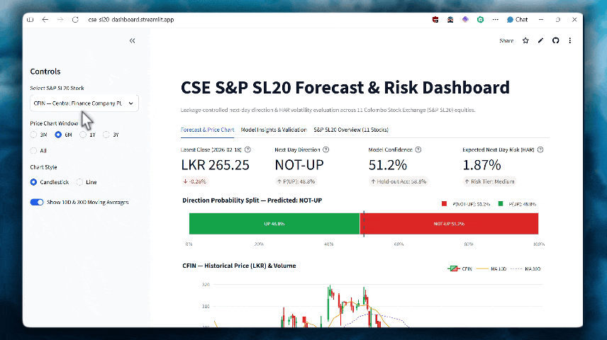

# CSE S&P SL20 Forecast & Risk Dashboard

[](https://www.python.org/)
[](https://streamlit.io/)
[](https://scikit-learn.org/)
[](#leakage-controlled-methodology)

> **Live Demo:** [https://cse-sl20-dashboard.streamlit.app/](https://cse-sl20-dashboard.streamlit.app/)

An interactive **Streamlit + Plotly** dashboard built on a pre-registered, leakage-controlled machine learning study of **11 Colombo Stock Exchange (S&P SL20)** equities (`CFIN`, `COMB`, `DIAL`, `HAYL`, `HHL`, `HNB`, `JKH`, `LOLC`, `NDB`, `SAMP`, `VONE`).

---

## Dashboard Features

1. **Forecast & Price Chart (`Tab 1`)**
   - Pick any of the 11 S&P SL20 stocks to view the **latest close (LKR)**, **next-day direction (`UP` / `NOT-UP`)**, **model confidence score**, and **HAR expected intraday risk range (%)** (`Low` / `Medium` / `High` tier).
   - Interactive Plotly **Candlestick / Close Line** chart with **10D & 30D moving averages**, **Volume subplot**, and `3M / 6M / 1Y / 3Y / All` window controls.
2. **Model Insights & Validation (`Tab 2`)**
   - Hold-out benchmark tables comparing **Random Forest** vs. **Majority Class**, **Previous-Day Rule**, and **Logistic Regression** (Direction) and **HAR (OLS)** vs. **Random Forest**, **22-Day Mean**, and **Historical Mean** (Volatility/Risk).
   - **Hold-out Permutation Feature Importance** chart and **Confusion Matrix** heatmap.
3. **S&P SL20 Overview (`Tab 3`)**
   - Cross-stock comparison of Direction Accuracy vs. Majority Baseline and HAR Out-of-Sample *R*² across all 11 stocks, plus a downloadable CSV summary.

---

## Key Empirical Findings

Once look-ahead leakage, forward-filled holiday rows, and structural breaks are strictly controlled:

| Track | Primary Model | Statistical Test | Significant Stocks (Holm *p* < 0.05) | Key Takeaway |
|---|---|---|---|---|
| **Next-Day Direction (H1)** | Tuned Random Forest (12 stationary features) | One-sided Binomial + Holm–Bonferroni | **0 / 11** | Daily direction is near-random; ML does not reliably beat the majority baseline. |
| **Next-Day Risk / Range (H2)** | HAR (OLS on 1D, 5D, 22D range) | Diebold–Mariano (Newey–West HAC) + Holm | **11 / 11** vs. Historical Mean | Volatility clustering is strongly predictable (median OOS *R*² = **0.197**). |

---

## Leakage-Controlled Methodology

- **Pre-Registered Protocol ([`configs/protocol.yaml`](configs/protocol.yaml)):** Universe (`seed = 42`), cleaning rules, feature list, splits, and statistical tests locked before evaluation.
- **Structural Break & Purge Protocol ([`src/cleaning.py`](src/cleaning.py)):** Drops zero-volume forward-filled holiday rows and flags calendar gaps `>= 6` days or `|return| >= 50%`, purging 30 post-break rows and isolating rolling features inside `regime_id`.
- **Chronological 80/20 Split + 10-Day Embargo ([`src/split.py`](src/split.py)):** Hyperparameter tuning uses `TimeSeriesSplit(5)` strictly inside the training set, with a 10-trading-day embargo gap before the hold-out test set.

---

## Demo Preview



---

## Project Structure

```text
├── .streamlit/config.toml         # Dashboard theme configuration
├── app/
│   ├── predictor.py               # Read-only data loader & cached inference engine
│   ├── charts.py                  # Interactive Plotly chart builders
│   └── streamlit_app.py           # Main 3-tab Streamlit dashboard
├── configs/protocol.yaml          # Frozen pre-registered study protocol
├── data/
│   ├── raw_cse/                   # Cleaned/raw CSE OHLCV CSVs
│   └── processed/                 # Stationary direction & risk feature CSVs
├── results/
│   ├── summary_11_stocks.csv      # Frozen 11-stock benchmark & Holm p-value table
│   └── per_stock/*.json           # Per-stock hold-out metrics & permutation importance
├── src/                           # Reproducible research pipeline (cleaning, features, split, models, stats)
├── tests/test_app_smoke.py        # Smoke tests across all 11 S&P SL20 stocks
└── requirements.txt               # Minimal Streamlit Cloud-compatible dependencies
```

---

## Run Locally

```powershell
# 1. Create and activate virtual environment
python -m venv .venv
.\.venv\Scripts\Activate.ps1

# 2. Install dependencies
pip install -r requirements.txt

# 3. Launch dashboard
streamlit run app/streamlit_app.py
```

Run smoke tests across all 11 stocks:

```powershell
python -m unittest tests/test_app_smoke.py
```

*Disclaimer: This is an academic research prototype for educational and portfolio demonstration purposes only. It is not financial or investment advice.*
